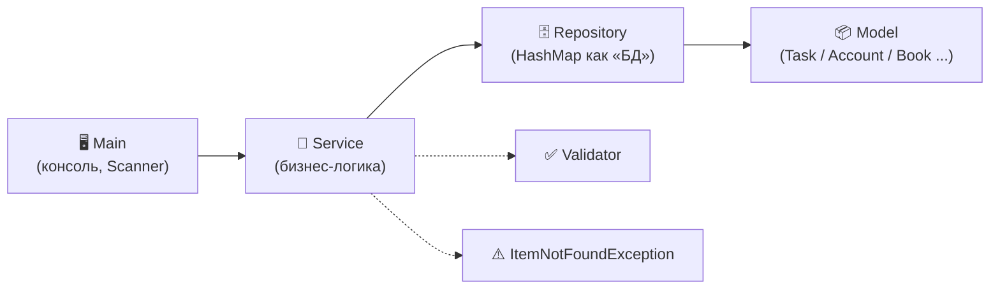

<div align="center">

# ☕ Java Core Pet Projects

**Консольные приложения на чистой Java**

</div>

---

## 📖 О репозитории

Набор мини-проектов, которые я пишу, чтобы закрепить **Java Core**.
Каждый проект — отдельное консольное приложение с одинаковой архитектурой, но своей предметной областью и новыми нюансами.

---

## 🗂 Проекты

| # | Проект | Предметная область | Ключевая особенность | Пакет |
|---|--------|--------------------|----------------------|-------|
| 1 | [📝 Task Tracker](#1--task-tracker) | Список задач | Первое знакомство со слоями и DI | `my_miniProjects.p01_firstStep` |
| 2 | [🏦 Bank Service](#2--bank-service) | Банковские счета | Переводы, кастомное исключение, `Validator` | `my_miniProjects.p02_bankService` |
| 3 | [📚 Library Service](#3--library-service) | Библиотека | Состояние объекта (выдана / в наличии) | `my_miniProjects.p03_libraryService` |
| 4 | [👥 Employee Registry](#4--employee-registry) | Сотрудники | Повышение зарплаты в %, поиск по должности | `newLevelProjects.p02_employeeRegistry` |
| 5 | [🚗 Fleet Management](#5--fleet-management) | Автопарк | Учёт пробега, поиск по модели | `newLevelProjects.p03_fleetManagement` |

---

## 🏗 Архитектура

Во всех проектах используется одна и та же **слоистая архитектура**. Каждый слой отвечает только за своё:



| Слой | Ответственность |
|------|-----------------|
| **Main** | Меню, ввод через `Scanner`, перехват исключений и вывод сообщений пользователю |
| **Service** | Бизнес-правила, проверка входных данных, выбрасывание исключений |
| **Repository** | Хранение данных в `Map<Integer/String, Entity>`, автогенерация ID (имитация `AUTO_INCREMENT`) |
| **Model** | Сущность с полями, геттерами, `toString()` и собственной логикой (`deposit`, `borrowBook`, `addMileage`...) |
| **Validator** | Статические проверки строк и чисел с понятными сообщениями об ошибках |
| **Exception** | `ItemNotFoundException extends RuntimeException` — «сущность не найдена» |

### Применяемые приёмы

- 🔌 **Dependency Injection через конструктор** — сборка приложения в `Main`
- 🔒 **Инкапсуляция** — `private` поля, `final` для неизменяемых данных
- 🧱 **Валидация в конструкторах и сеттерах** — объект не может оказаться в некорректном состоянии
- 🚨 **Кастомные исключения** и разделение «ошибка ввода» / «не найдено»
- 🗃 **`HashMap` + автоинкремент ID** в репозитории
- 🧭 **Multi-catch** (`catch (A | B e)`) в `Main`
- 🔍 Поиск без учёта регистра через `equalsIgnoreCase`

---

## 1. 📝 Task Tracker

Простой менеджер задач — первый проект, на котором отрабатывалась слоистая структура.

**Возможности**
- ➕ Добавить задачу
- 📋 Показать все задачи
- ✅ Отметить задачу выполненной
- 🗑 Удалить задачу

**Модель `Task`:** `id`, `title`, `isCompleted`, `createAt` (дата создания ставится автоматически через `LocalDateTime.now()`).

**Правила**
- Название задачи не может быть пустым
- Поиск и удаление по ID; если задачи нет — пользователь получает сообщение об ошибке

```
my_miniProjects/p01_firstStep/
├── Main.java            # меню и ввод
├── Task.java            # модель
├── TaskRepository.java  # хранилище + генератор ID
└── TaskService.java     # бизнес-логика
```

---

## 2. 🏦 Bank Service

Мини-банк со счетами, пополнением, снятием и переводами.

**Возможности**
- 🆕 Открыть счёт (номер генерируется автоматически: `ACC-1`, `ACC-2`, ...)
- 💰 Пополнить счёт
- 💸 Снять деньги
- 🔁 Перевести деньги между счетами
- 📋 Показать все счета

**Правила**
- Имя владельца и номер счёта не могут быть пустыми
- Суммы должны быть положительными
- Нельзя снять больше, чем есть на балансе
- Нельзя перевести деньги самому себе
- Несуществующий счёт → `ItemNotFoundException`

```
my_miniProjects/p02_bankService/
├── Main.java
├── Account.java
├── AccountRepository.java
├── BankService.java
├── Validator.java
└── ItemNotFoundException.java
```

---

## 3. 📚 Library Service

Учёт книг в библиотеке с выдачей и возвратом.

**Возможности**
- ➕ Добавить книгу
- 📋 Показать доступные для выдачи книги
- 📖 Взять книгу
- ↩️ Вернуть книгу

**Правила**
- Название и автор обязательны
- Нельзя взять книгу, которая уже выдана
- Нельзя вернуть книгу, которая не была выдана
- Книга не найдена → `ItemNotFoundException`

```
my_miniProjects/p03_libraryService/
├── Main.java
├── Book.java
├── LibraryRepository.java
├── LibraryService.java
├── Validator.java
└── ItemNotFoundException.java
```

---

## 4. 👥 Employee Registry

Реестр сотрудников компании.

**Возможности**
- ➕ Нанять сотрудника (имя, должность, зарплата)
- 📋 Показать всех сотрудников
- 📈 Повысить зарплату на N %
- ❌ Уволить сотрудника
- 🔍 Найти сотрудников по должности (без учёта регистра)

**Правила**
- Имя, должность — непустые строки; зарплата и процент повышения — положительные
- Зарплата валидируется ещё и в сеттере модели `Employee`
- Несуществующий ID → `ItemNotFoundException`

```
newLevelProjects/p02_employeeRegistry/
├── Main.java
├── Employee.java
├── EmployeeRepository.java
├── EmployeeService.java
├── Validator.java
└── ItemNotFoundException.java
```

---

## 5. 🚗 Fleet Management

Система учёта автопарка.

**Возможности**
- ➕ Добавить машину (гос. номер, модель, пробег)
- 📋 Показать все машины
- 🛣 Добавить пробег
- 🗑 Удалить машину
- 🔍 Найти машины по модели (без учёта регистра)

**Правила**
- Гос. номер и модель обязательны
- Начальный пробег не может быть отрицательным
- Добавляемый пробег должен быть положительным
- Несуществующий ID → `ItemNotFoundException`

```
newLevelProjects/p03_fleetManagement/
├── Main.java
├── Vehicle.java
├── VehicleRepository.java
├── VehicleService.java
├── Validator.java
└── ItemNotFoundException.java
```

---

## ▶️ Как запустить

1. Установите **JDK 8+** (например, через [Adoptium](https://adoptium.net/)).
2. Склонируйте репозиторий:
   ```bash
   git clone https://github.com/<your-username>/<your-repo>.git
   ```
3. Откройте папку в **IntelliJ IDEA** (`File → Open`).
4. Выберите нужный проект и запустите его `Main.java` (`Shift + F10`).

Либо из терминала (пример для Bank Service):

```bash
mvn compile
java -cp target/classes my_miniProjects.p02_bankService.Main
```

---

## 🧪 Пример работы (Bank Service)

```text
Добро пожаловать в банковскую систему

=================================
1. Открыть новый счёт
2. Пополнить счёт
3. Снять деньги
4. Перевести деньги
5. Показать все счета
0. Выход
=================================
👉 Выберите действие (введите цифру): 1
Введите имя: Иван
Введите баланс: 1000
Счёт успешно создан! Ваш номер счёта: ACC-1
```

---

## 🛠 Стек

`Java Core` · `Collections (HashMap, List)` · `Exceptions` · `java.time` · `Scanner` · `IntelliJ IDEA`

---

<div align="center">

⭐ Если проекты оказались полезными — поставьте звезду!

</div>